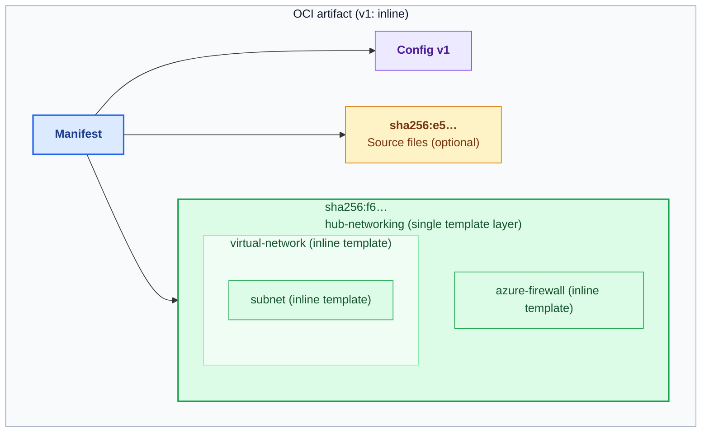
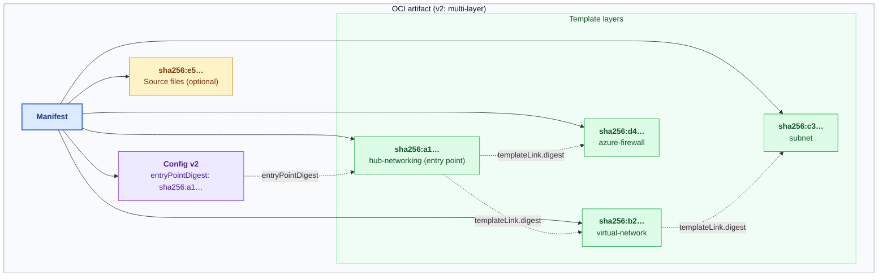

# Link registry modules instead of inlining their compiled templates

## Summary

Today, Bicep inlines the compiled template of every module in a registry module's closure, both when published and when consumed. Stitching multiple modules together or authoring a large module quickly hits ARM's 4 MiB template limit.

This REP builds on [OCI Template Links (Azure/bicep-reps#26)](https://github.com/Azure/bicep-reps/pull/26), which addresses this limit by publishing the complete deployment as a self-contained OCI artifact. This proposal adds a complementary path: link already-published registry modules without requiring customers to publish their consumer project. Customers can use either approach according to their template composition and publishing workflow.

## Terms and definitions

- **OCI terms** (manifest, config blob, layer, digest, tag): Defined in the [OCI image spec](https://github.com/opencontainers/image-spec).
- **Template layer**: A layer (`application/vnd.ms.bicep.module.layer.v1+json`) containing one compiled ARM JSON template.
- **Entry point layer**: The root template layer deployed when an artifact is referenced by `ociReference`.
- **Inline format (v1)**: Today's artifact format—one template layer with all child modules inlined.
- **Multi-layer format (v2)**: The new artifact format—one template layer per distinct module in the closure.
- **Closure**: A module plus all modules it references transitively.
- **Artifact context**: The artifact (`<registry>/<repository>@<manifest-digest>`) a template was loaded from. `templateLink.digest` resolves against it, and inline nested templates inherit it.
- **Linking**: Emitting `templateLink.ociReference` or `templateLink.digest` instead of an inline `template`.
- **DRP**: Deployments Resource Provider (`Microsoft.Resources/deployments`).
- **MAR**: Microsoft Artifact Registry (`mcr.microsoft.com`), which hosts public Bicep modules including [AVM](https://azure.github.io/Azure-Verified-Modules/).
- **ACR**: Azure Container Registry.
- **OBO**: OAuth 2.0 [On-Behalf-Of flow](https://learn.microsoft.com/entra/identity-platform/v2-oauth2-on-behalf-of-flow).

## Motivation

A compiled Bicep file grows with every module in its closure and is subject to ARM's [4 MiB template limit](https://learn.microsoft.com/azure/azure-resource-manager/templates/best-practices#template-limits). Composing reusable modules or scaling a deployment can exceed this limit even when each individual module fits within it. This applies to public modules, private organizational modules, and locally authored modules alike.

Publishing the complete deployment as an OCI artifact addresses size pressure across the whole composition. However, customers whose template size is dominated by already-published registry modules may only need to link those modules, rather than introducing a separate project-publishing step for content that is already available in a supported registry.

### Customer scenarios

This REP and the whole-deployment publishing proposal support complementary customer scenarios:

1. **AVM module consumers.** Composing several individually deployable AVM modules can exceed the consumer template's limit. Linking existing modules on MAR shrinks that template without waiting for publishers to republish them or requiring consumers to publish their own project.
2. **Private ACR module publishers and consumers.** Similar to AVM, organizations that share private ACR modules can link them in consumer projects without publishing the consumer projects separately to ACR.
3. **Customers publishing whole deployments or oversized modules.** Customers whose local content or module closure exceeds 4 MiB, or who prefer to package their complete deployment, may use the full-deployment publishing workflow in [Azure/bicep-reps#26](https://github.com/Azure/bicep-reps/pull/26).

### Primary and secondary proposals

- **Primary proposal: link existing registry modules.** Consumers can use already-published modules without publishing their Bicep projects to ACR, whilst benefitting from reduced deployment payload size.
- **Secondary proposal: support modules with oversized dependency closures.** Linking a module may bring the initial PUT payload under 4 MiB, but nested deployment PUTs can still fail if the combined size of its inlined dependencies exceed the limit. Packaging module templates as separate, "linked templates" where each source file is represented as a spearate layer can enable very large module closures, and help cut down on overall artifact size if some base modules are reused many times.

## Detailed design

This REP adds registry-module reference emission while building on the OCI publishing and deployment support in [Azure/bicep-reps#26](https://github.com/Azure/bicep-reps/pull/26):

- Allow the Bicep compiler to embed a _reference_ to a registry module, rather than inlining its content during emission:

  ```bicep
  module vnet 'br/public:avm/res/network/virtual-network:0.8.0' = {
    name: 'vnet'
    params: { ... }
  }
  ```

  Compiles to a linked deployment instead of an inlined `properties.template`:

  ```jsonc
  {
    "type": "Microsoft.Resources/deployments",
    "name": "vnet",
    "properties": {
      "templateLink": {
        "ociReference": "mcr.microsoft.com/bicep/avm/res/network/virtual-network:0.8.0@sha256:7e…"
      },
      "parameters": { ... }
    }
  }
  ```

- For the secondary proposal, use the multi-layer OCI artifact format shared with [Azure/bicep-reps#26](https://github.com/Azure/bicep-reps/pull/26) during Bicep publish to store each module as an individual layer, rather than inlining everything into one layer (see [artifact format](#artifact-format)).
- Allow the deployment engine to fetch nested templates from an OCI reference at deploy time.

### Artifact format

This proposal lets DRP resolve `templateLink.ociReference` to either the existing **inline (v1)** format or the proposed **multi-layer (v2)** format. 

<details>
<summary><b>V1: today's inline format</b></summary>

Today, a published module has a manifest referencing a v1 config blob, a single compiled template layer, and an optional source layer. The template layer contains **the entry point and all child templates inlined recursively**. The nested boxes below represent content within that one layer, not separate layers.



The entire compiled template layer must fit under 4 MiB. Under this proposal, consumers can link an existing v1 artifact directly with `templateLink.ociReference`, without republishing it.

</details>

<details>
<summary><b>V2: proposed multi-layer format</b></summary>

In v2, each distinct module template is stored as a separate layer instead of being inlined into its parent. The v2 config identifies the entry point through `entryPointDigest`, and parent templates reference child layers through `templateLink.digest`. The manifest describes every layer in the closure, keeping the artifact self-contained.



</details>

### Client side changes

#### Emitting

Add a new setting in `bicepconfig.json` that controls how registry modules are emitted during `bicep build`:
- To embed a reference, user chooses `reference`.
- (Default) To inline the module template, user chooses `inline`.

```json5
{
    "analyzers": {...},
    "emitter": {
        "registryModules": "reference" // "inline" (default) | "reference"
    }
}
```
If the value is set to `reference`, Bicep emits `<registry>/<repository>@<manifest digest>` for registry modules.

> Bicep emits the manifest digest so DRP deploys the exact artifact resolved during compilation, even if its tag is subsequently overwritten. The digest pins the artifact’s config and all template layers.  

#### Publishing

Add a new optional CLI argument `--artifact-format` to `bicep publish` to control the artifact format used when publishing a registry module:

```sh
bicep publish <file-path> `
    --target br:<registry>/<repository>:<tag> `
    [--artifact-format inline|multi-layer]
```

- `inline`: Publishes a single template layer with all dependencies inlined recursively (v1).
- `multi-layer`: Publishes each distinct module in the closure as a separate template layer, linked by `templateLink.digest` within the same artifact (v2).

#### Restoring

Restore should work the same if using v1 registry module artifact format.

If using v2 registry module artifact format:
- `bicep restore` downloads all template layers in a v2 artifact into the module cache, storing the entry point layer (`entryPointDigest`) as `main.json` and child layers by digest. 
- In VS Code, Ctrl+clicking a v2 module still opens `main.json` (or the Bicep source if available).
    - Optionally, we could add an experience to Ctrl+click into individual modules, but this is out of scope for this spec.

#### Compatibility with Bicep versions

Publishing or restoring v2 artifacts requires customers to use a Bicep version that supports the multi-layer format. 

Older versions already reject the unrecognized v2 config media type with the following diagnostic:

> Did not expect config media type "application/vnd.ms.bicep.module.config.v2+json". A newer version of Bicep might be required to reference this artifact.

#### Handling environment differences

Because the registry host is fixed in the compiled output, users targeting another environment (such as an air-gapped cloud's MAR) can extend their config, override the alias, and pass `--config`.

```jsonc
// bicepconfig.airgapped.json
{
  "extends": "./bicepconfig.json",
  "artifacts": {
    "aliases": {
      "avm": {
        "type": "oci",
        "registry": "<air-gapped MAR host>",
        "repositoryPrefix": "bicep/avm"
      }
    }
  }
}
```

```sh
bicep build main.bicep --config ./bicepconfig.airgapped.json --out-file main.airgapped.json
# -> "ociReference": "<air-gapped MAR host>/bicep/avm/ptn/network/hub-networking:1.0.0@sha256:9c…"
```

See [REP 0023](../final/0023-bicep-configuration-inheritance.md) for configuration inheritance, [REP 0022](./0022-artifact-aliases-and-redirects.md#overriding-a-predefined-alias) for alias overrides, and [REP 0029](https://github.com/Azure/bicep-reps/pull/29) for `--config`.

### Server side changes


#### Resolving an `ociReference`

1. DRP verifies the registry host is on the cloud's allowlist (see [Registry access](#registry-access)).
2. DRP resolves and verifies the manifest (by digest if present, otherwise by tag), and pins the manifest digest for the rest of the deployment.
3. DRP accepts config media types `v1` and `v2`, and deploys the entry point layer (the single template layer in v1, or `entryPointDigest` in v2). 
4. For v2 artifacts, DRP pulls nested templates by reading the OCI layer specified by the nested template's `templateLink.digest`. It also validates that the layer is under 4 MiB in size while streaming its content.

#### Constraints on templates loaded from an artifact

Nested deployments inside an artifact template (including inline nested templates) may use only an inline `template` or `templateLink.digest`. DRP rejects `uri`, `id`, `relativePath`, `queryString`, `contentVersion`, and `ociReference`. This ensures the OCI artifact is self-contained, and nested templates are not reaching outside the artifact context.


#### Private ACR authentication

Following [#26](https://github.com/Azure/bicep-reps/pull/26), private ACRs will also be supported via the Entra OBO Auth exchange.

#### Registry access
| Allowed hosts | Authentication |
| --- | --- |
| The cloud's MAR host (e.g., `mcr.microsoft.com`) | Anonymous |
| The cloud's ACR login servers (e.g., `*.azurecr.io`) | Caller's permissions, via Entra OBO exchange |

### Microsoft.Resources/deployments API changes

A new API version adds two properties to `templateLink` (neither can be combined with existing `templateLink` properties):

| Property | Description |
| --- | --- |
| `ociReference` | OCI link in the form: `<registry>/<repository>`, with `@<digest>` or `:<tag>`. Bicep always emits `@<digest>`; if both are present, the digest takes precedence and the tag is ignored. |
| `digest` | Content hash (digest) of a nested template layer. |

### Examples

Consuming `virtual-network:0.8.0` (works with both existing v1 and new v2 artifacts):

```bicep
module vnet 'br/public:avm/res/network/virtual-network:0.8.0' = {
  name: 'vnet'
  params: { ... }
}
```

Emitted with `"registryModules": "reference"` (with `"inline"`, `properties.template` is inlined as today):

```json5
{
    "type": "Microsoft.Resources/deployments",
    "name": "vnet",
    "properties": {
        "templateLink": {
            "ociReference": "mcr.microsoft.com/bicep/avm/res/network/virtual-network:0.8.0@sha256:7e…"
        }
    }
}
```

## Tradeoffs

1. **Compatibility of v2 artifacts.** The v2 registry module format doesn't work with older Bicep versions; users must update to a compatible version.
   > Older Bicep versions already emit a clear upgrade diagnostic when encountering `config.v2`, and publishers can note minimum Bicep version requirements in module release notes.
1. **Deploy-time registry access.** Deployment identities now need pull permissions on any private ACRs referenced by linked modules.
1. **Deploy-time availability and retention.** Deployments depend on registry availability and rate limits at runtime, and purging untagged manifests in ACR can break previously compiled templates pinned by digest.
   > Document ACR retention best practices (prefer immutable tags and avoid purging manifests still referenced by active deployments).
1. **DRP network fetch cost.** Shifting module resolution to DRP adds network fetches across linked artifacts and v2 layers at deploy time.
   > Could consider caching digests in DRP across nested deployments.

## Alternatives

## Rollout plan

1. **Bicep (experimental):** Ship publishing and emitting behind experimental flag
1. **DRP feature flag:** Gate `ociReference` and `digest` behind a feature flag for allowlisted subscriptions.
1. **Pilot:** Allow cohort group of subscriptions/tenants to test out the feature
1. **Public preview** Release preview API version and allow all tenants
1. **GA:** Release stable API version, release feature & docs generally, and remove Bicep experimental flag
    - Would still leave the `emitter` setting available for users to opt-in/out of embedding the OCI reference 

## Unresolved questions

1. **Template Specs inside v1 modules.** A v1 registry module that references a Template Spec (`ts:`) emits `templateLink.id` in its compiled template. If a consumer links that v1 module via `ociReference`, DRP will reject it because external links (`templateLink.id`) are blocked inside artifact templates.
    - **Recommended:** Emit a compile-time error in `bicep build` when a linked v1 module contains a `templateLink.id`, directing the user to either inline the module or republish it in v2 format (which packages the Template Spec as a layer at publish time).
    - **Alternative:** Allow `templateLink.id` in DRP for v1 artifacts, though this breaks self-containment and could transitively reference external URIs.

## Out of scope

- **Registries other than MAR and ACR**, such as GitHub Container Registry or Docker Hub. Registries that don't trust Entra need a different credential model, such as a Key Vault–backed credential or perhaps secure params ([#26](https://github.com/Azure/bicep-reps/pull/26)).
- **Network-restricted registries**, such as registries behind a firewall or private endpoint. A possible future path is ACR support for [Network Security Perimeter](https://learn.microsoft.com/azure/private-link/network-security-perimeter-concepts) with the `AzureResourceManager` service tag.
- **Registries in a different Entra tenant** from the caller.

## Appendix

### Impact on template size

The following AVM pattern modules were measured on MAR on 2026-10-21 (default indented JSON). "Largest nested template today" is the biggest single nested deployment with its children inlined; the last three columns estimate the multi-layer (v2) format by splitting at every nested deployment.

| Module | Inline today (v1) | Largest nested template today | Nested deployments | Distinct layers (v2) | Largest layer (v2) | All layers (v2) |
| --- | ---: | --- | ---: | ---: | ---: | ---: |
| `avm/ptn/aca-lza/hosting-environment:0.6.3` | 3.18 MiB | 1.32 MiB (`supportingServices`) | 183 | 88 | 88 KiB | 1.32 MiB |
| `avm/ptn/lz/sub-vending:0.8.0` | 2.66 MiB | 2.24 MiB (`createSubscriptionResources`) | 188 | 65 | 224 KiB | 1.08 MiB |
| `avm/ptn/ai-ml/ai-foundry:0.7.0` | 1.45 MiB | 0.44 MiB (`storageAccount`) | 88 | 57 | 121 KiB | 0.90 MiB |

- **Linking existing (v1) modules:** A landing zone using both `sub-vending` (2.66 MiB) and `hosting-environment` (3.18 MiB) compiles to ~5.8 MiB inline and fails. Linking those existing v1 modules with `templateLink.ociReference` lets DRP fetch each (< 4 MiB) when its nested deployment runs.
- **multi-layer (v2) format:** When a single module's closure exceeds 4 MiB, top-level linking isn't enough because DRP submits each nested deployment separately (for example, `createSubscriptionResources` in `sub-vending` is 2.24 MiB inline across 185 nested deployments). The v2 format links modules by `templateLink.digest` at every level of the closure: no single request exceeds 224 KiB, and deduplicating identical layers shrinks total artifact size by 38–59%.
