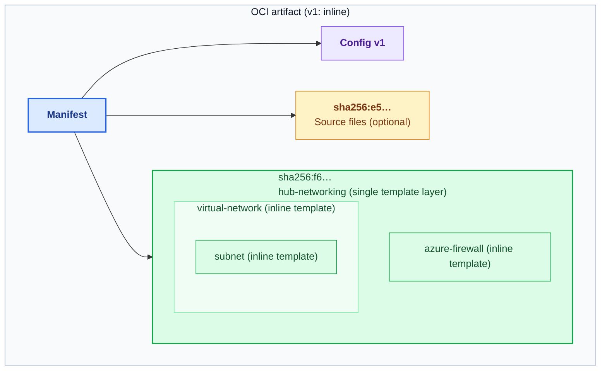
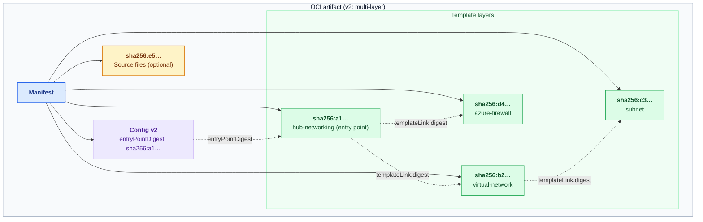

# Linking registry modules in Bicep

## Summary

Today, Bicep inlines the compiled template of every module in a registry module's closure, both when published and when consumed. Stitching multiple modules together or authoring a large module quickly hits ARM's 4 MiB template limit.

This REP builds on [OCI Template Links (Azure/bicep-reps#26)](https://github.com/Azure/bicep-reps/pull/26), which addresses this limit by publishing the complete deployment as a self-contained OCI artifact. This proposal adds a complementary path: link already-published registry modules without requiring customers to publish their consumer project. Customers can use either approach according to their template composition and publishing workflow.

## Motivation

A compiled Bicep file grows with every module in its closure and is subject to ARM's [4 MiB template limit](https://learn.microsoft.com/azure/azure-resource-manager/templates/best-practices#template-limits). Composing reusable modules or scaling a deployment quickly exceeds this limit even when each individual module fits within it.

Publishing the complete deployment as an OCI artifact ([Azure/bicep-reps#26](https://github.com/Azure/bicep-reps/pull/26)) addresses size pressure across the whole composition. However, customers whose template size is dominated by already-published registry modules may prefer to link those modules directly rather than introducing a separate project-publishing step.

### Customer scenarios

This REP and the whole-deployment publishing proposal ([Azure/bicep-reps#26](https://github.com/Azure/bicep-reps/pull/26)) support complementary customer scenarios:

1. **Public MAR / AVM module consumers.** Composing several individually deployable AVM modules can push a consumer template over 4 MiB. Linking existing modules on MAR shrinks that template without waiting for publishers to republish them or requiring consumers to provision a private ACR and publish their own project.
2. **Private ACR module publishers and consumers.** Similar to AVM, organizations that share private ACR modules can link them in consumer projects without publishing the consumer projects separately to ACR.
3. **Customers with large templates or whole-deployment workflows.** Customers whose local templates (even without registry modules) or module closures exceed 4 MiB, or who prefer to package their complete deployment as an artifact, can publish the full deployment to ACR using [Azure/bicep-reps#26](https://github.com/Azure/bicep-reps/pull/26).

### Proposals

This REP addresses module size pressure in two complementary steps:

1. **Primary proposal: link existing registry modules at build time (`templateLink.ociReference`).** When compiling a consumer template, Bicep can emit an OCI reference to a registry module instead of inlining its template. DRP fetches each linked module when its nested deployment executes, allowing consumers to compose multiple `< 4 MiB` modules (including existing v1 modules on MAR and ACR) without changing their deployment workflow.
2. **Secondary proposal: publish modules in multi-layer format (`templateLink.digest`).** Linking a top-level module brings the initial deployment under 4 MiB, but nested deployment PUTs still fail if a single module's closure—or one of its inner nested deployments—exceeds 4 MiB. Publishing a module in the multi-layer (v2) format stores each distinct module in its closure as a separate layer linked by `templateLink.digest`, enabling large module closures and shrinking total artifact size when base modules are reused multiple times.

## Terms and definitions

- **OCI terms** (manifest, config blob, layer, digest, tag): Defined in the [OCI image spec](https://github.com/opencontainers/image-spec).
- **Template layer**: A layer (`application/vnd.ms.bicep.module.layer.v1+json`) containing one compiled ARM JSON template.
- **Entry point layer**: The root template layer deployed when an artifact is referenced by `ociReference`.
- **Inline format (v1)**: Today's artifact format—one template layer with all child modules inlined.
- **Multi-layer format (v2)**: The new artifact format—one template layer per distinct module in the closure.
- **Closure**: A module plus all modules it references transitively (both local and registry modules).
- **Artifact context**: The artifact (`<registry>/<repository>@<manifest-digest>`) a template was loaded from. `templateLink.digest` resolves against it, and inline nested templates inherit it.
- **DRP**: Deployments Resource Provider (`Microsoft.Resources/deployments`).
- **MAR**: Microsoft Artifact Registry (`mcr.microsoft.com`), which hosts public Bicep modules including [AVM](https://azure.github.io/Azure-Verified-Modules/).

## Detailed design

The detailed design is organized around the two proposals:

1. **[Primary proposal: linking registry modules (`templateLink.ociReference`)](#primary-proposal-linking-registry-modules-templatelinkocireference)** — Emit OCI references to registry modules during `bicep build` and resolve them in DRP at deploy time. This works with existing v1 modules on MAR and ACR without republishing.
2. **[Secondary proposal: multi-layer module artifacts (`templateLink.digest`)](#secondary-proposal-multi-layer-module-artifacts-templatelinkdigest)** — Publish and restore modules in a multi-layer (v2) OCI format where each distinct module in the closure is stored as a separate layer and fetched by DRP via `templateLink.digest`.

---

### Primary proposal: linking registry modules (`templateLink.ociReference`)

At a high level, the primary proposal allows the Bicep compiler to emit a reference (`templateLink.ociReference`) to a registry module during `bicep build` rather than inlining its compiled template, and updates DRP to resolve that reference at deploy time.

#### Client-side changes

##### Emitting

Add a new setting in `bicepconfig.json` that controls how registry modules are emitted during `bicep build`:
- To embed a reference, user chooses `reference`.
- (Default) To inline the module template, user chooses `inline`.

```json5
{
    "analyzers": {...},
    "emitter": {
        "registryModules": "reference" // "inline" (default) | "reference"
    }
}
```
If the value is set to `reference`, Bicep emits `<registry>/<repository>@<manifest-digest>` for registry modules.

> Bicep emits the manifest digest so DRP deploys the exact artifact resolved during compilation, even if its tag is subsequently overwritten. The digest pins the artifact's config and all template layers, similar to pinning a GitHub Action to a commit SHA.

##### Recording the original reference

A digest alone does not tell readers which module version it came from. Bicep records each linked module's original reference in the template's top-level `metadata`, keyed by module symbolic name:

```jsonc
{
  "metadata": {
    "_generator": { ... },
    "__bicep_registry_module_sources!": {
      "vnet": "br:mcr.microsoft.com/bicep/avm/res/network/virtual-network:0.8.0"
    }
  }
}
```

- **Informational only.** DRP does not read or validate this entry; `ociReference` stays the source of truth.
- **No user conflicts.** The key follows the existing `__bicep_exported_variables!` convention. Bicep already rejects user `metadata` names starting with `_` (BCP268), and `!` is not valid in a Bicep identifier. A user `metadata` declaration therefore can't produce or overwrite this key.

##### Supported registries

When `"registryModules": "reference"` is set, a new linter rule flags any registry module whose host is not the target cloud's MAR host or an ACR login server (for example, `*.azurecr.io`).

- **Fail at authoring time.** Users find out before deployment, not when DRP rejects the host.
- **ACR custom domains are flagged.** Bicep can't verify that a custom domain resolves to ACR. Users can reference the registry's `*.azurecr.io` login server in their config instead.
- **No partial linking.** To consume an unsupported registry, keep `"registryModules": "inline"` for that project. The rule can be relaxed once DRP supports more registries (see [Out of scope](#out-of-scope)).

##### Handling environment differences

Because the registry host is fixed in the compiled output, users targeting another environment (such as an air-gapped cloud's MAR) can extend their config, override the alias, and pass `--config`.

```jsonc
// bicepconfig.airgapped.json
{
  "extends": "./bicepconfig.json",
  "artifacts": {
    "aliases": {
      "avm": {
        "type": "oci",
        "registry": "<air-gapped MAR host>",
        "repositoryPrefix": "bicep/avm"
      }
    }
  }
}
```

```sh
bicep build main.bicep --config ./bicepconfig.airgapped.json --out-file main.airgapped.json
# -> "ociReference": "<air-gapped MAR host>/bicep/avm/ptn/network/hub-networking@sha256:9c…"
```

See [REP 0023](../final/0023-bicep-configuration-inheritance.md) for configuration inheritance, [REP 0022](./0022-artifact-aliases-and-redirects.md#overriding-a-predefined-alias) for alias overrides, and [REP 0029](https://github.com/Azure/bicep-reps/pull/29) for `--config`.

#### Server-side changes

##### Resolving an `ociReference`

1. DRP verifies the registry host is on the cloud's allowlist (see [Registry access](#registry-access)).
2. DRP resolves the manifest by digest, verifies it, and pins it for the rest of the deployment.
3. DRP streams the template layer and deploys the entry point template. While streaming, DRP checks that the layer is under 4 MiB and that its content hash matches its digest.

> DRP verifies each layer lazily, as part of the pull, rather than verifying the whole artifact up front. Hash verification protects against a compromised registry serving different content for a pinned digest.

##### Constraints on templates loaded from an artifact

To ensure an OCI artifact is self-contained and nested templates do not reach outside the artifact context, nested deployments inside an artifact template (including inline nested templates) may not use external links (`uri`, `id`, `relativePath`, `queryString`, `contentVersion`, or `ociReference`).

**Exception for v1 artifacts:** DRP allows `templateLink.id` (Template Spec references) when resolving a v1 artifact (`config.v1`). Existing v1 modules that use a Template Spec (`ts:`) already deploy today when inlined, so blocking them when linked would be a breaking change. Publishers don't need to republish.

v2 artifacts stay strict: nested deployments may use only inline `template` or `templateLink.digest`.

##### Private ACR authentication

Following [#26](https://github.com/Azure/bicep-reps/pull/26), private ACRs will also be supported via the Entra OBO Auth exchange.

##### Registry access

| Allowed hosts | Authentication |
| --- | --- |
| The cloud's MAR host (e.g., `mcr.microsoft.com`) | Anonymous |
| The cloud's ACR login servers (e.g., `*.azurecr.io`) | Caller's permissions, via Entra OBO exchange |

#### Example: Linking a registry module in a consumer template

Consuming `virtual-network:0.8.0`:

```bicep
module vnet 'br/public:avm/res/network/virtual-network:0.8.0' = {
  name: 'vnet'
  params: { ... }
}
```

When built with `"registryModules": "reference"`, Bicep emits `templateLink.ociReference` instead of inlining `properties.template`:

```jsonc
{
  "type": "Microsoft.Resources/deployments",
  "name": "vnet",
  "properties": {
    "templateLink": {
      "ociReference": "mcr.microsoft.com/bicep/avm/res/network/virtual-network@sha256:7e…"
    },
    "parameters": { ... }
  }
}
```

---

### Secondary proposal: multi-layer module artifacts (`templateLink.digest`)

Linking a top-level module via `templateLink.ociReference` brings the consumer's initial deployment under 4 MiB, but nested deployment PUTs still fail if a single module's closure—or one of its inner nested deployments—exceeds 4 MiB.

The secondary proposal introduces a **multi-layer (v2)** OCI artifact format that stores each distinct module in a published module's closure as an individual layer linked via `templateLink.digest`. DRP resolves `templateLink.ociReference` transparently for both existing **inline (v1)** artifacts and new **multi-layer (v2)** artifacts.

#### Artifact format (v1 vs. v2)

<details>
<summary><b>V1: today's inline format</b></summary>

Today, a published module has a manifest referencing a v1 config blob, a single compiled template layer, and an optional source layer. The template layer contains **the entry point and all child templates inlined recursively**. The nested boxes below represent content within that one layer, not separate layers.



The entire compiled template layer must fit under 4 MiB. Under the primary proposal, consumers can link an existing v1 artifact directly with `templateLink.ociReference`, without republishing it.

</details>

<details>
<summary><b>V2: proposed multi-layer format</b></summary>

In v2, each distinct module template is stored as a separate layer instead of being inlined into its parent. The v2 config identifies the entry point through `entryPointDigest`, and parent templates reference child layers through `templateLink.digest`. The manifest describes every layer in the closure, keeping the artifact self-contained.



</details>

#### Client-side changes

##### Publishing

Add a new optional CLI argument `--artifact-format` to `bicep publish` to control the artifact format used when publishing a registry module:

```sh
bicep publish <file-path> `
    --target br:<registry>/<repository>:<tag> `
    [--artifact-format inline|multi-layer]
```

- `inline` (default): Publishes a single template layer with all dependencies inlined recursively (v1).
- `multi-layer`: Publishes each distinct module in the closure—including both local modules and transitive registry modules—as a separate template layer linked by `templateLink.digest` within the same artifact (v2), keeping the published artifact self-contained.

##### Restoring

Restore works the same as today when restoring a v1 registry module artifact.

When restoring a v2 registry module artifact:
- `bicep restore` downloads all template layers in a v2 artifact into the module cache, storing the entry point layer (`entryPointDigest`) as `main.json` and child layers by digest.
- When building a consumer template with `"registryModules": "inline"` (the default), Bicep reconstructs and inlines the full module tree from the cached layers. When built with `"registryModules": "reference"`, Bicep emits `templateLink.ociReference` just as it does for v1 modules.
- In VS Code, Ctrl+clicking a v2 module still opens `main.json` (or the Bicep source if available).
    - Optionally, we could add an experience to Ctrl+click into individual modules, but this is out of scope for this spec.

##### Compatibility with Bicep versions

Publishing or restoring v2 artifacts requires customers to use a Bicep version that supports the multi-layer format.

Older versions already reject the unrecognized v2 config media type with the following diagnostic:

> Did not expect config media type "application/vnd.ms.bicep.module.config.v2+json". A newer version of Bicep might be required to reference this artifact.

#### Server-side changes

##### Resolving v2 artifacts and `templateLink.digest`

1. When resolving a `templateLink.ociReference`, DRP accepts both `v1` and `v2` config media types. For `v2` (`application/vnd.ms.bicep.module.config.v2+json`), DRP reads `entryPointDigest` from the config blob to locate and deploy the entry point layer.
2. Within a v2 artifact context, nested deployments may reference other layers in the same artifact manifest using `templateLink.digest` (in addition to inline `template`).
3. When a nested deployment specifies `templateLink.digest`, DRP verifies the digest is declared as a template layer in the pinned artifact manifest. DRP then streams the layer, checks its size (< 4 MiB) and content hash, and deploys it within the same artifact context.

Identical module templates produce identical digests, so a v2 artifact stores each shared module once.

#### Example: Inside a multi-layer (v2) module artifact

When `hub-networking:1.0.0` is published with `--artifact-format multi-layer`, its v2 config (`application/vnd.ms.bicep.module.config.v2+json`) identifies the entry point layer:

```jsonc
{
  "entryPointDigest": "sha256:a1…"
}
```

And the entry point layer (`sha256:a1…`) references child module layers (such as `virtual-network`) within the same artifact using `templateLink.digest`:

```jsonc
{
  "type": "Microsoft.Resources/deployments",
  "name": "vnet",
  "properties": {
    "templateLink": {
      "digest": "sha256:b2…"
    },
    "parameters": { ... }
  }
}
```

---

### Summary of `Microsoft.Resources/deployments` API changes

A new API version adds two properties to `templateLink` (neither can be combined with existing `templateLink` properties):

| Property | Proposal | Description |
| --- | --- | --- |
| `ociReference` | Primary | OCI link in the form `<registry>/<repository>@<digest>`. Tags are not accepted; DRP rejects references without a digest or with a tag. |
| `digest` | Secondary | Content hash (digest) of a nested template layer within the current artifact context. |

## Tradeoffs

1. **Compatibility of v2 artifacts.** The v2 registry module format doesn't work with older Bicep versions; users must update to a compatible version.
   > Older Bicep versions already emit a clear upgrade diagnostic when encountering `config.v2`, and publishers can note minimum Bicep version requirements in module release notes.
1. **Deploy-time registry access.** Deployment identities now need pull permissions on any private ACRs referenced by linked modules.
1. **Deploy-time availability and retention.** Deployments depend on registry availability and rate limits at runtime, and purging untagged manifests in ACR can break previously compiled templates pinned by digest.
   > Document ACR retention best practices (prefer immutable tags and avoid purging manifests still referenced by active deployments).
1. **DRP network fetch cost.** Shifting module resolution to DRP adds network fetches across linked artifacts and v2 layers at deploy time.
   > Digest-addressed layers are immutable, so DRP could cache them across nested deployments and deployments (for example, popular AVM modules). Caching is deferred until fetch metrics show it is needed.

## Alternatives

1. **Rely solely on whole-deployment publishing ([#26](https://github.com/Azure/bicep-reps/pull/26)).** Requiring every consumer to publish their root deployment as an OCI artifact forces customers who only consume public AVM modules on MAR to provision and manage a private ACR and alter their CI/CD pipelines. Supporting `templateLink.ociReference` for registry modules lets those consumers deploy their templates directly without introducing a publishing step.
2. **Make `"reference"` the default for `emitter.registryModules`.** Emitting references is primarily needed when templates approach the 4 MiB limit, and linking requires deploy-time registry support—which is not yet available for non-ACR/MAR registries, network-restricted registries, or cross-tenant registries (see [Out of scope](#out-of-scope)). Until those scenarios are supported, emitting references should remain opt-in.
3. **Emit `templateLink.ociReference` for transitive registry modules inside a v2 artifact instead of packaging the full closure as `templateLink.digest` layers.** Packaging the entire closure into layers within the published artifact guarantees self-containment, immutability under a single manifest digest, and a single registry authentication boundary at deploy time.
4. **Accept tags in `ociReference`.** A tag is mutable, so the content could change between compile and deploy. Digest-only references keep deployments reproducible. Accepting tags later would be non-breaking.
## Rollout plan

1. **Experimental / Private preview:** Ship `emitter.registryModules` and `bicep publish --artifact-format` behind a Bicep experimental flag, and gate `templateLink.ociReference` and `templateLink.digest` in DRP behind a feature flag for allowlisted subscriptions.
1. **Pilot:** Validate end-to-end with a cohort of customers and AVM module publishers/consumers on allowlisted subscriptions and tenants.
1. **Public preview:** Release a preview `Microsoft.Resources/deployments` API version and enable DRP support across all tenants.
1. **GA:** Release a stable API version, remove the Bicep experimental flag (keeping `emitter.registryModules` as an opt-in setting in `bicepconfig.json`), and publish general documentation.

## Unresolved questions


1. ✅ **Template Specs inside v1 modules.** A v1 registry module that references a Template Spec (`ts:`) emits `templateLink.id` in its compiled template. If DRP blocks `templateLink.id` inside all artifact templates, linking an existing v1 module that uses a Template Spec via `ociReference` would fail at deploy time.
    - **Option A (backward-compatible in DRP):** Allow `templateLink.id` in DRP when resolving v1 artifacts (`config.v1`), while keeping v2 artifacts strictly restricted to inline `template` and `templateLink.digest`. This lets consumers link existing v1 modules that reference Template Specs without requiring publishers to republish them.
    - **Option B (compile-time error in Bicep):** Reject `templateLink.id` in DRP for all artifacts and emit a compile-time error in `bicep build` when a linked v1 module contains a `templateLink.id`, directing the user to either inline the module or republish it in v2 format.
    - **Decision: Option A.** Blocking Template Specs in existing v1 modules would break them; v2 stays strict. See [Constraints on templates loaded from an artifact](#constraints-on-templates-loaded-from-an-artifact).
2. ✅ **Mixing supported and unsupported registries in the same template.** `emitter.registryModules` is a project-wide setting, so enabling `"reference"` would also emit `ociReference` for registries DRP cannot reach (such as network-restricted ACRs, cross-tenant ACRs, or non-MAR/ACR registries).
    - **Option A (linter rule for non-MAR/ACR registries):** Add a linter rule that warns when `"registryModules": "reference"` is enabled and a module references a non-MAR/ACR registry host.
    - **Option B (per-module decorator):** Add a decorator (such as `@inline()`) on `module` declarations to selectively inline specific modules.
    - **Option C (per-registry override under `emitter` in `bicepconfig.json`):** Add an override map keyed by resolved registry host under `emitter`, keeping `.bicep` files free of environment-specific mechanics and working for both aliased and direct `br:` references:
      ```jsonc
      {
        "emitter": {
          "registryModules": "reference",
          "registryModuleOverrides": {
            "ghcr.io": "inline"
          }
        }
      }
      ```
    - **Decision: Option A.** A linter rule flags non-MAR/ACR hosts at authoring time, including ACR custom domains. No per-module or per-registry overrides; mixing registries in one project is expected to be rare. See [Supported registries](#supported-registries).

## Out of scope

- **Registries other than MAR and ACR**, such as GitHub Container Registry or Docker Hub. Registries that don't trust Entra need a different credential model, such as a Key Vault–backed credential or perhaps secure params ([#26](https://github.com/Azure/bicep-reps/pull/26)).
- **ACR custom domains.** Bicep can't verify that a custom domain points to ACR. Users must reference the `*.azurecr.io` login server instead.
- **Network-restricted registries**, such as registries behind a firewall or private endpoint. A possible path is ACR support for [Network Security Perimeter](https://learn.microsoft.com/azure/private-link/network-security-perimeter-concepts) with the `AzureResourceManager` service tag, but this is something ACR has not committed to supporting at the moment.
- **Registries in a different Entra tenant** from the caller - one potential option here could be to leverage:
    - ARM's [`x-ms-authorization-auxiliary`token](https://learn.microsoft.com/en-us/azure/azure-resource-manager/management/authenticate-multi-tenant) 
    - Deployment `identity` (customer grants `AcrPull` to a multi-tenant App Registration backed by a User-Assigned Managed Identity (via Federated Identity Credentials))

## Appendix

### Impact on template size

Measurements of three AVM pattern modules on MAR (default indented JSON):

| Module | Total size today (v1) | Largest nested template today | Largest layer (v2) | Total estimated size (v2) |
| --- | ---: | --- | ---: | ---: |
| `avm/ptn/aca-lza/hosting-environment:0.6.3` | 3.18 MiB | 1.32 MiB | 88 KiB | 1.32 MiB |
| `avm/ptn/lz/sub-vending:0.8.0` | 2.66 MiB | 2.24 MiB | 224 KiB | 1.08 MiB |
| `avm/ptn/ai-ml/ai-foundry:0.7.0` | 1.45 MiB | 0.44 MiB | 121 KiB | 0.90 MiB |

- **Linking existing (v1) modules:** Composing `sub-vending` (2.66 MiB) and `hosting-environment` (3.18 MiB) inline produces a ~5.8 MiB template that exceeds the 4 MiB limit. Linking them via `templateLink.ociReference` lets DRP fetch each module (< 4 MiB) when its nested deployment runs.
- **Multi-layer (v2) format:** Linking each module in the closure by `templateLink.digest` keeps every individual layer under 224 KiB and reduces total artifact size by 38–59% through layer deduplication.
